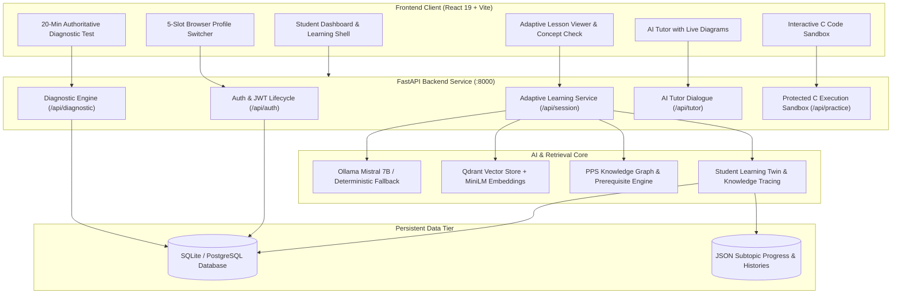
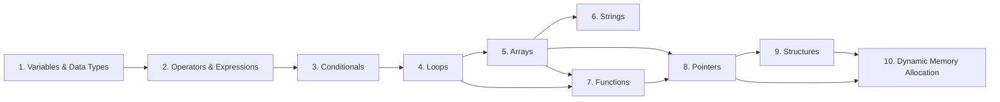

# 🎓 EduAdapt: Intelligent Adaptive Learning Platform
### Programming for Problem Solving (PPS) — C Programming Curriculum

[](https://www.python.org/downloads/)
[](https://react.dev/)
[](https://fastapi.tiangolo.com/)
[](https://vitejs.dev/)
[](https://www.sqlalchemy.org/)
[](https://qdrant.tech/)
[](https://ollama.ai/)
[](LICENSE)

**EduAdapt** is a deterministic, AI-powered adaptive learning system built specifically for the **Programming for Problem Solving (PPS)** undergraduate C programming curriculum. It blends calibrated diagnostic cognitive testing, automated pedagogical content generation, dynamic prerequisite knowledge graphs, semantic RAG retrieval, and real-time C code execution.

---

## 📑 Table of Contents

- [Architectural Scope & Module Ownership](#-architectural-scope--module-ownership)
- [System Architecture](#-system-architecture)
- [Key Platform Features](#-key-platform-features)
- [Curriculum Topics & Prerequisite DAG](#-curriculum-topics--prerequisite-dag)
- [Project Directory Structure](#-project-directory-structure)
- [Prerequisites & Technology Stack](#-prerequisites--technology-stack)
- [Installation & Quickstart Guide](#-installation--quickstart-guide)
- [Environment Configuration](#-environment-configuration)
- [Testing & Quality Verification](#-testing--quality-verification)
- [API Documentation](#-api-documentation)

---

## 📌 Architectural Scope & Module Ownership

EduAdapt enforces a **strictly non-agentic, deterministic pipeline**—eliminating autonomous loop hallucination in favor of verifiable pedagogical templates, strict schema validation, and grounded retrieval.

### Module Breakdown:
1. **Member 1: GenAI & Teaching Personalization Module**
   - LLM Inference layer supporting local **Ollama (Mistral 7B)** with transparent, offline curriculum fallbacks.
   - Student-aware prompt rendering via `PersonalizationEngine` based on mastery tiers (*Beginner*, *Intermediate*, *Advanced*) and pacing (*Deliberate*, *Moderate*, *Fast*).
   - Structured pedagogical content: Learning Objectives, Conceptual Explanations, C99 Implementations, Step-by-Step Walkthroughs, Common Pitfalls, and Concept Checks.
   - Live AI Tutor with automated Mermaid diagram validation.
   - Dynamic adaptive roadmap generation and targeted remediation hints.

2. **Member 2: PPS Curriculum RAG Module**
   - Multi-format document parsing (`.pdf`, `.txt`, `.md`, `.pptx`).
   - C-code-preserving tokenization and AST/code-block intact semantic chunking.
   - Dense vector embeddings using `sentence-transformers/all-MiniLM-L6-v2`.
   - Local embedded persistent vector storage via **Qdrant**.
   - Offline semantic retrieval engine with Hit@K, Recall@K, and MRR evaluation harnesses.

3. **Member 3: Student Modeling & Learning Twin**
   - Baseline cognitive assessment engine (105-question bank across 10 reasoning categories).
   - Authoritative 20-minute server countdown timer with autosave and auto-submission.
   - Knowledge tracing, mastery estimation, and state persistence.
   - Multi-profile switching architecture (up to 5 concurrent student accounts per browser session).

4. **Member 4: Accessibility Module**
   - Web Speech API integration for bidirectional voice interactions (Speech-to-Text & Text-to-Speech).
   - Modality formatters for screen readers, high-contrast themes, and assistive devices.

---

## 🏛️ System Architecture



---

## ✨ Key Platform Features

- ⏱️ **Server-Authoritative 20-Minute Diagnostic Exam**: Deterministically selects 25 balanced questions across 10 cognitive aptitude domains. Automatically locks learning routes until baseline calibration is completed.
- 🔒 **Topic Prerequisite Enforcement**: Topics follow a strict directed acyclic graph (DAG). Advanced topics (Pointers, DMA, Structures) unlock only upon verified subtopic mastery.
- 💡 **Clean Concept Checks**: In-lesson understanding checks with instant verification, C code output tracing, and immediate misconception feedback.
- 🛠️ **Protected C Execution Sandbox**: Executes student code submissions in isolated subprocesses with 30s timeouts, memory bounds, and standard library inspection.
- 📊 **Dynamic Mermaid Diagrams**: Automatically generates and renders architecture and memory layout flowcharts for complex C concepts.
- 👥 **In-Browser Multi-Profile Manager**: Switch between 5 independently authenticated student profiles within the same browser session with complete token isolation.
- 🛡️ **Zero-Failure Fallback Engine**: If local Ollama is offline or `mistral:7b` is not installed, the system activates deterministic PPS curriculum templates without throwing runtime errors.

---

## 🗺️ Curriculum Topics & Prerequisite DAG

EduAdapt structures the PPS C Programming course across 10 core topics:



---

## 📂 Project Directory Structure

```text
EduAdapt/
├── .env.example                         # Environment configuration template
├── .gitignore                            # Comprehensive git ignore rules
├── README.md                             # Project documentation
├── requirements.txt                      # Unified Python backend dependencies
├── alembic.ini                           # Database migration settings
├── data/
│   ├── eduadapt.db                       # Pre-seeded SQLite development database
│   ├── assessment_data.csv               # Historical assessment dataset
│   ├── student_subtopic_progress.json    # Subtopic progress state store
│   ├── tutor_history.json                # AI tutor conversation threads
│   ├── benchmark/                        # GenAI evaluation problems & rubrics
│   └── raw/pps/                          # PPS curriculum source documents
├── frontend/                             # React 19 + Vite Frontend SPA
│   ├── package.json                      # Frontend dependencies
│   ├── vite.config.js                    # Vite bundler configuration
│   ├── src/
│   │   ├── App.jsx                       # Main application shell & router
│   │   ├── api/                          # REST client bindings
│   │   ├── components/                   # UI components (TeachingContent, Diagrams, etc.)
│   │   └── pages/                        # Views (Learn, Practice, Dashboard, Diagnostic, etc.)
├── migrations/                           # Alembic relational schema versions
├── member3/                              # Student modeling & learning twin logic
├── member4/                              # Audio narration & assistive interfaces
├── scripts/
│   ├── seed_diagnostic_questions.py      # Seed 105 diagnostic questions into SQL
│   └── rag/                              # Ingestion & retrieval CLI utilities
├── src/eduadapt/                         # Core Python FastAPI Application
│   ├── api.py                            # FastAPI entry point & API route handlers
│   ├── config.py                         # Pydantic environment settings
│   ├── adapters/                         # Learning twin contracts
│   ├── curriculum/                       # PPS topic trees & mastery thresholds
│   ├── db/                               # SQLAlchemy async sessions, models, and security
│   ├── inference/                        # Ollama & Mock LLM abstraction clients
│   ├── prompts/                          # Deterministic prompt templates
│   ├── rag/                              # Semantic retriever & vector store interfaces
│   ├── services/                         # Business logic services (auth, diagnostic, learning)
│   └── teaching/                         # Content generator, response schema, diagrams
└── tests/                                # Test suites (Pytest & Playwright)
```

---

## 💻 Prerequisites & Technology Stack

- **Python**: Version `3.11` to `3.13` (64-bit)
- **Node.js**: Version `18.x` to `22.x` & `npm`
- **Compiler (Optional for Code Execution)**: `gcc` or `clang` in PATH (for running C code submissions)
- **LLM Engine (Optional)**: [Ollama](https://ollama.ai/) with `mistral:7b` (fallback engine works without it)

---

## 🚀 Installation & Quickstart Guide

### 1. Clone the Repository
```bash
git clone https://github.com/<your-username>/EduAdapt.git
cd EduAdapt
```

### 2. Configure Backend Environment
```bash
# Copy template environment file
cp .env.example .env
```
*(By default, `.env` is configured to use the local SQLite database at `./data/eduadapt.db` and fallback inference).*

### 3. Install Python Dependencies
```bash
pip install -r requirements.txt
```

### 4. Install Frontend Dependencies
```bash
cd frontend
npm install
cd ..
```

---

## 🏃 Running the Application

### Start the Backend API Server:
```bash
# From the project root directory:
python -c "import sys; sys.path.insert(0, 'src'); import uvicorn; uvicorn.run('eduadapt.api:app', host='127.0.0.1', port=8000)"
```
- API will be accessible at: **`http://127.0.0.1:8000`**
- Swagger interactive documentation: **`http://127.0.0.1:8000/docs`**

### Start the Frontend Client:
```bash
# In a separate terminal:
cd frontend
npm run dev
```
- Web Application will be live at: **`http://127.0.0.1:5173`**

### (Optional) Enable Live Mistral 7B Local LLM:
To use live generative AI rather than curriculum fallback templates:
```bash
ollama pull mistral:7b
ollama run mistral:7b
```

---

## ⚙️ Environment Configuration

Key parameters in `.env`:

| Variable | Default Value | Description |
|---|---|---|
| `APP_ENV` | `development` | Deployment environment (`development` / `production`) |
| `LLM_PROVIDER` | `ollama` | Inference client (`ollama` or `mock`) |
| `LLM_MODEL_NAME` | `mistral:7b` | Model name for Ollama inference |
| `LLM_API_BASE` | `http://localhost:11434` | Ollama local server URL |
| `DATABASE_URL` | `sqlite+aiosqlite:///./data/eduadapt.db` | Async database connection string |
| `JWT_SECRET_KEY` | *(configured secret)* | Secret key for HS256 auth tokens |
| `JWT_ACCESS_TOKEN_EXPIRE_MINUTES` | `1440` | Token validity duration (24 hours) |

---

## 🧪 Testing & Quality Verification

Run the automated test suites using `pytest`:

```bash
# Run core smoke tests
python -m pytest tests/test_smoke.py -v

# Run authentication and database tests
python -m pytest tests/test_auth.py tests/test_database.py -v

# Run end-to-end multi-student learning progression flow
python -m pytest tests/test_multi_student_flow.py -v

# Run complete test suite
python -m pytest tests/ -v
```

---

## 📡 API Documentation

Once the backend is running, explore all endpoints interactively at **[http://127.0.0.1:8000/docs](http://127.0.0.1:8000/docs)**:

- `POST /api/auth/register` — Student registration with Argon2id password hashing
- `POST /api/auth/login` — Authentication & JWT issuance
- `GET /api/diagnostic/start` — Start authoritative 20-min diagnostic attempt
- `POST /api/diagnostic/submit` — Submit diagnostic answers & calibrate mastery tier
- `POST /api/session/generate` — Generate adaptive, personalized PPS lesson
- `POST /api/subtopics/mastery-check/submit` — Submit Concept Check question & unlock next subtopic
- `POST /api/tutor/chat` — Context-grounded AI tutor conversation with Mermaid diagrams
- `POST /api/practice/execute` — Subprocess C code compilation and test execution
